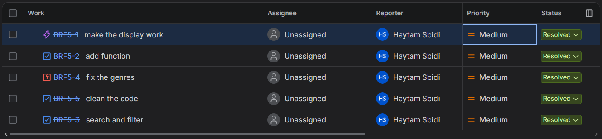

# SérieScope – Catalogue de séries

## Description du projet

**serie scope** une application web interactive developée pour une médiathèque permetant à mettre à disposition de ses visiteurs un catalogue en ligne de séries et de documentaires.

Cette application permet deparcourir le catalogue et retrouver les titres d'un genre.

L'equipe de la médiathèque peut à tout temps ajouter modifier ou suprimer les titres affichée.

Le projet est développé avec **HTML5, Tailwind CSS et JavaScript Vanilla**et liée avec une API 'https://seriescope-api.vercel.app/api/series'.

----

## objectifs du project 

- Créer une application web interactive et responsive.
- Manipuler le DOM avec JavaScript.
- Gérer les événements utilisateur.
- Ajouter et supprimer dynamiquement les series.
- Valider les données d'un formulaire.
- Afficher des messages d'erreur et de confirmation.

## Fonctionalitées de base 

**Affichage de series:**
- afficher d'une maniere dinamique les series
- presentation sous forme de tableau

**Ajout de nouvelle serie:**
- ajout simple et direct de serie avec leurs titres et description.
- assigner à chaque serie son genre 

**suppression d'une serie:**
- Chaque serie possède un bouton « Supprimer ».
- Le tableau est actualisée automatiquement après suppression.

**recherche et filtrage**
- l'affichage du tableau depand du mot recherchée et du genre choisis.

## devision de travail avec jira 

